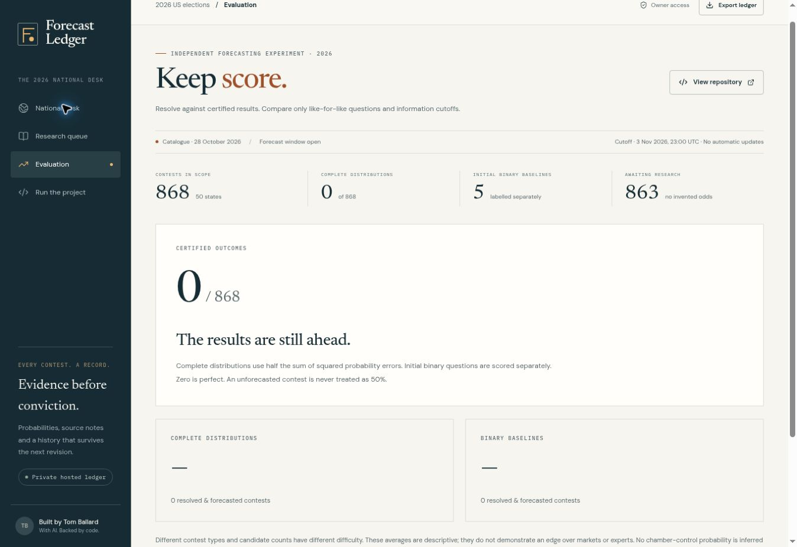

# Forecast Ledger

**A national election forecasting workbench built by Tom Ballard with AI assistance.** Browse 868 contests, research any candidate slate, review source-linked probability distributions, preserve revisions, and score certified results. Includes a standalone local app and the private hosted demo.

[Hosted demo](https://forecast-ledger-tom.tcballard19941011.chatgpt.site) · [Data provenance](data/provenance.json) · [Architecture](docs/ARCHITECTURE.md) · [Research workflow](docs/RESEARCH.md)



## Run it

Requirements: **Node 22.13+** and **pnpm 11.25.0**. If pnpm is absent: `npm install -g pnpm@11.25.0`.

```sh
git clone https://github.com/tcballard/forecast-ledger.git
cd forecast-ledger
pnpm install --frozen-lockfile
pnpm local
```

Open **http://localhost:4174**. This is a private repository; clone with your authenticated GitHub account (or use GitHub Desktop). No Cloudflare account or AI key is required to run the local application. Font loading is optional; system fonts work offline.

`pnpm local` builds the React interface and starts a Node server bound to loopback. SQLite is initialized automatically in `.ledger/forecasts.sqlite`; records survive restarts. Keep that directory to retain your work. Shut the server down before copying the directory for a backup. Set `PORT=4175` or `LEDGER_DB=/absolute/path/ledger.sqlite` to change defaults. On Windows PowerShell use `$env:PORT="4175"` before running.

```sh
pnpm test                  # validation, coverage, scoring, SQLite persistence
pnpm typecheck
pnpm build:local
node tests/http-smoke.mjs
node tests/research-smoke.mjs
```

The smoke tests create and remove isolated temporary databases. They do not change your ledger or call a paid provider. Node 22 may print an experimental SQLite warning; Node 24 is also supported and was used for verification.

## What “all” means

| Category | Contests |
|---|---:|
| U.S. House — every voting seat | 435 |
| U.S. Senate elections | 35 |
| Governors | 36 |
| Other statewide contests | 218 |
| Statewide ballot measures | 144 |
| **Total** | **868** |

The source is the complete 863-entry BallotBench catalogue captured on 28 October 2026. Five unopposed House districts omitted there were added from 270toWin: FL-10, MA-02, MA-05, MA-07 and WI-02. Their supplemental provenance is retained on each record. An explicit `Other / write-in` residual keeps these from being falsely declared certified wins. This scope does **not** include state legislative, municipal or territorial elections. The catalogue is a versioned source snapshot, not an automatically maintained official candidate registry.

**Coverage is not fabricated:** the repo ships the five original exploratory binary Senate baselines. The other 863 contests start awaiting research. A binary baseline predicts one named candidate versus all other outcomes; it is labelled separately from a complete candidate probability distribution. No national AI run or independently validated forecasting edge is claimed.

## Run the research pipeline

```sh
pnpm research briefs --all
pnpm research run --all --provider codex --limit 10
pnpm research coverage
```

**Using LiteLLM instead?** The runner also supports `--provider litellm` with your gateway URL, virtual key and model alias. Both Responses and Chat Completions routes are supported, with explicit web search or supplied evidence packets. See [LiteLLM setup](docs/RESEARCH.md#litellm-api-no-cli-required).

The Codex adapter requires your locally installed, authenticated Codex CLI and working web research access. It passes a contest-specific prompt through stdin, uses a read-only sandbox and saves validated proposals to `research-output/proposals/`. Model runs consume your provider allowance. `--limit` is a hard cap on attempted jobs per invocation (default 10); existing valid proposal files are skipped. To process the whole catalogue, explicitly use `--limit 868`. Failed jobs and abstentions are logged separately and retried on the next run. This does not schedule recurring jobs.

Review a proposal's evidence and counting rules, then load it into the app and commit it. Or explicitly import one reviewed file into the local database:

```sh
pnpm research validate research-output/proposals/2026-TX-S.json
pnpm research import research-output/proposals/2026-TX-S.json
```

Use `--state TX`, `--office House`, or `--contest 2026-TX-S` to narrow research. Other providers work through the documented stdin/stdout command adapter. See [RESEARCH.md](docs/RESEARCH.md) for setup, schema, resuming, provider requirements and honest limitations. The app never starts model calls automatically and the runner never imports proposals automatically.

## What is implemented

- Search, office/state/status filters and pagination over the complete catalogue.
- Candidate-level distributions, including multicandidate races, measures, retention and runoff/RCV notes.
- Evidence review, strict JSON validation and append-only server timestamps.
- Full ledger export, research briefs, bounded resumable runner, explicit local imports.
- Final certified outcome recording after the common cutoff; corrections append new records.
- Separate scoring for complete distributions and legacy binary questions.
- Local SQLite mode plus hosted Cloudflare D1 mode using the same forecasting rules.
- The hosted `/lab` route preserves the earlier five-race sensitivity model and fixed benchmark comparison.

## Protocol and limits

Forecasts lock at **2026-11-03T23:00:00Z**. The backend enforces the cutoff. Probabilities refer to final victory (including runoff/RCV), not first-round vote share. The runner asks for current evidence and an abstention if research is unavailable. URL validation is not factual verification; a human must review claims. Ballot-measure thresholds and state rules require contest-specific research.

Complete distributions use `0.5 × Σ(pᵢ − yᵢ)²`, which equals binary Brier for two outcomes. Initial binary questions use `(p − y)²` and are reported separately. Results are descriptive: candidate counts and contest difficulty vary, forecasts are correlated, and five initial baselines do not establish calibration. The initial baselines were prepared after seeing comparator forecasts, so they are not a blind experiment.

There is no live market ingestion, scheduled refresh, joint chamber-control model, independent timestamp commitment, or multi-provider leaderboard yet. This is an executable forecasting workflow, not a claim that 868 contests have already been independently researched.

## Storage and deployment

The standalone and hosted databases are separate. Exports are portable records; proposals can be imported into either through the UI. There is no silent cross-device sync. Local mode binds `127.0.0.1`, checks Host and Origin, and requires no login. Do not expose that local server to a network. Hosted mode relies on the private Sites access boundary; add server-side write authorization before changing its audience.

The checked-in pnpm lockfile is the supported dependency path. The repository also contains hosting-specific Vinext/D1 files; those are unnecessary for normal local use. Hosted schema migrations are in `drizzle/`; they contain no test records or seeds.

Source data retains its third-party provenance. No license or ownership over third-party datasets is asserted. No credentials, database contents, generated research or local provider configuration are committed.
